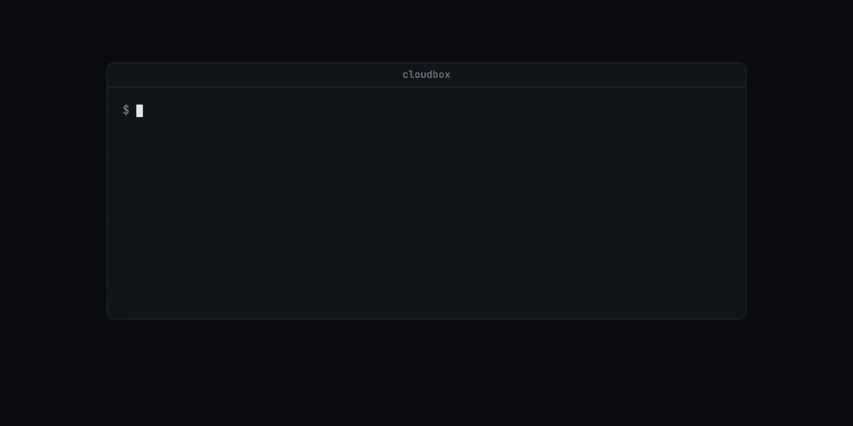
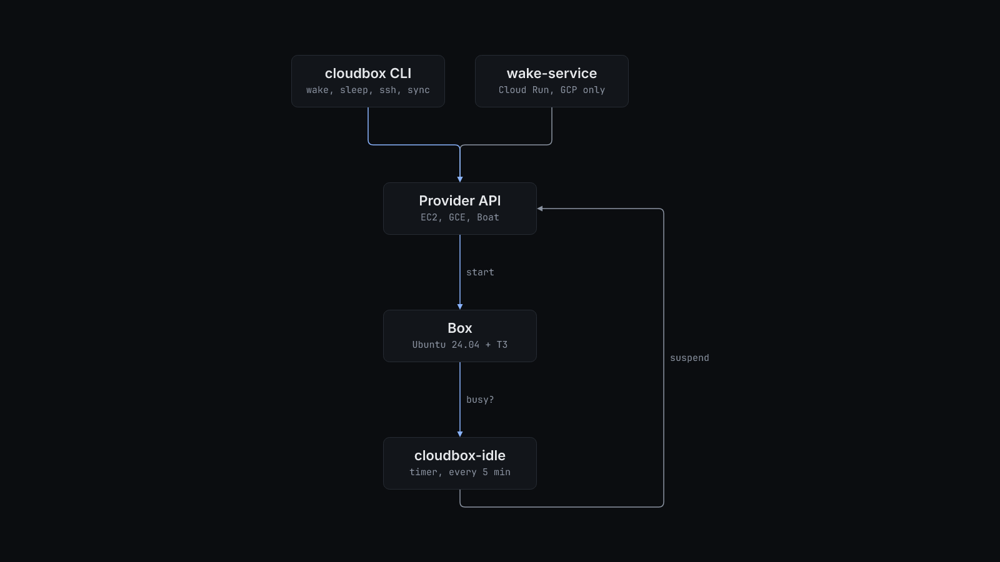

# cloudbox

`cloudbox` is a command-line tool that creates, wakes, sleeps and checks one personal development machine in your own AWS, Google Cloud or Boat account.



## Why

A large cloud machine for coding agents costs money every hour it runs, and most of those hours nobody is using it. Cloudbox keeps one box per config file. On AWS and GCP a timer on the box checks for activity every 5 minutes and, after `idleMinutes` with no agent process, no T3 session and no keep-awake marker, hibernates the box through its own provider API. `cloudbox wake` brings it back with its memory intact and waits until SSH answers. The same config file drives identity sync, repository checkout and an acceptance suite, so a rebuilt box ends up set up the same way as the old one.

## Install

Requirements:

- Node.js 24.10 or later and pnpm 11.10.0 (`package.json` pins both).
- `ssh` and `rsync` on your machine.
- AWS: credentials that the AWS SDK default chain can find (`AWS_PROFILE`, `AWS_*` variables or SSO) and permission to create EC2, VPC, IAM and CloudFormation resources.
- GCP: the `gcloud` CLI on `PATH`. The CLI refuses to wake or SSH to a GCP box without it, because SSH goes through IAP.
- Boat: a Boat account API key, and WSL on Windows if you use the T3 desktop SSH environment.

The package is not published to npm. Clone it and build the CLI:

```bash
git clone <this repository> cloudbox
cd cloudbox
pnpm install --frozen-lockfile
pnpm build:cli
```

`pnpm build:cli` writes `dist/cli.mjs`. `pnpm build` also writes the on-box bundles (`dist/idle.mjs`, `dist/idle-aws.mjs`, `dist/machines.mjs`) and the Cloud Run bundle (`dist/wake-service.mjs`) that provisioning uploads.

## Quick start

None of these commands create cloud resources.

List the commands:

```console
$ pnpm -s cloudbox --help
DESCRIPTION
  Control and verify one personal Cloudbox machine on AWS, GCP, or Boat.

USAGE
  cloudbox <subcommand> [flags]
...
SUBCOMMANDS
  boat               Provision and operate the Boat provider lane.
  status             Show the box state, access path, and wake-service view.
  wake               Start or resume the box, wait for SSH, then print its host.
  sleep              Hibernate or suspend the box through its provider.
  sync               Push identity, repositories, and filtered T3 settings to the running box.
  bootstrap-clone    Clone allowlisted bootstrap paths from an existing box through a resumable local rsync cache.
  ssh                Open an interactive SSH session to the running box.
  verify             Run the end-to-end host acceptance suite over SSH.
  smoke-thread       Run autonomous pi and Codex agent turns through the remote T3 server.
  verify-sleep       Hibernate or suspend, wake, and prove memory survived.
  verify-idle        Leave the host untouched and verify automatic idle sleep.
```

Every command reads `cloudbox.json` from the current directory. Without one, it stops before it calls any provider:

```console
$ pnpm -s cloudbox status
ERROR (#1): ConfigError: Cannot read required config cloudbox.json: NotFound: FileSystem.readFile (cloudbox.json)
```

Copy the example for your provider and edit it:

```bash
cp cloudbox.example.json cloudbox.json        # AWS
cp cloudbox.gcp.example.json cloudbox.json    # GCP, full host (n2-standard-16)
cp cloudbox.test.example.json cloudbox.json   # GCP, smaller test host (n2-standard-8)
cp cloudbox.boat.example.json cloudbox.json   # Boat
```

The CLI validates the file before it does anything else. An AWS config with `"sshCidr": "0.0.0.0/0"` fails like this:

```console
$ pnpm -s cloudbox status
ERROR (#1): ConfigError: Invalid cloudbox.json: Expected <filter>
  at ["aws"]["sshCidr"]
```

A Boat config is accepted only by the `cloudbox boat` commands:

```console
$ pnpm -s cloudbox status
ERROR (#1): CloudboxCliError: This command supports AWS and GCP. Use the `cloudbox boat` command group for a Boat config.
```

When the config is right, provision and use the box. These steps create billable resources:

```bash
pnpm build
pnpm alchemy login --configure   # AWS or GCP
pnpm deploy                      # AWS or GCP: creates the box
pnpm cloudbox wake               # prints the host once SSH answers
pnpm cloudbox sync --dry-run
pnpm cloudbox sync
pnpm cloudbox verify
pnpm cloudbox sleep

pnpm cloudbox boat up            # Boat: create or resume, sync, write the SSH entry
pnpm cloudbox boat stop
```

## How it works



The CLI loads `cloudbox.json` (`src/config.ts`), checks it against an Effect Schema union of the three provider shapes, and dispatches on `provider`. Unknown fields are an error.

**AWS and GCP.** `pnpm deploy` runs `alchemy.run.ts`. AWS gets a VPC, a security group that allows TCP 22 only from `aws.sshCidr`, an IAM role that can stop only instances tagged `cloudbox=<name>`, and one Ubuntu 24.04 instance with an encrypted gp3 disk and hibernation enabled at launch. GCP gets an SSH firewall rule for the IAP range, a separate data disk, one Ubuntu 24.04 instance, and a Cloud Run wake service. The box bootstrap clones `t3.repoUrl` and runs the T3 server as a systemd user service on `127.0.0.1:3773`.

**Sleep.** `cloudbox-idle.timer` runs `/opt/cloudbox/idle.mjs` every 5 minutes. The box is busy when `/run/cloudbox/keepawake` exists, when a `claude`, `codex`, `pi` or `opencode` process runs, or when T3 reports an active session. Each idle check adds to a streak stored in `/var/lib/cloudbox/idle.json`. When the streak reaches `idleMinutes`, AWS calls `StopInstances` with `Hibernate=true` and GCP calls `instances.suspend`. If the gap between two checks is more than three intervals, the box has just resumed, so suspension waits another `idleMinutes`. Run `sudo touch /run/cloudbox/keepawake` on the box to keep it awake.

**Wake.** `cloudbox wake` starts or resumes the instance through the provider API, waits until SSH answers, and prints the host. On GCP, `cloudbox wake --via-service` asks the deployed Cloud Run service to do it with `CLOUDBOX_WAKE_URL` and `CLOUDBOX_WAKE_SECRET`, so the caller needs no GCP credentials.

**Verify.** `verify` runs named checks over SSH. `verify-sleep` sleeps and wakes the box and checks that uptime and a marker process survived. `verify-idle` leaves the box alone for `idleMinutes + 5` minutes and checks that it went to sleep. Each prints a table, or JSON with `--json`, and exits non-zero when a check fails.

**Boat.** Boat has no deploy step and no idle timer. `cloudbox boat up` creates or resumes one sandbox named `cloudbox-<name>`, sets its TTL to `boat.ttlSeconds`, syncs the identity paths, and writes a managed `Host cloudbox-<name>` block into the Windows OpenSSH config. `boat ssh`, `boat exec` and `boat proxy` refuse a stopped sandbox. Only `boat up` and `boat resume` start one. See [the Boat provider guide](docs/boat-provider.md).

**Sync.** `cloudbox sync` copies each `identity.paths` entry with rsync. It first runs a dry run, totals the bytes, and stops if the total exceeds `identity.maxTransferMb` unless you pass `--force`. It then clones or fetches each `repos` entry and, when `t3.settingsParity.enabled` is true, merges portable T3 settings. `bootstrap-clone --from-config <source.json>` copies paths allowlisted in both configs from another box through a private local cache. It never deletes files on the destination.

The [product description](docs/product-description.md) describes the lifecycle and the loadout clone event by event.

## Configuration

### cloudbox.json

No field has a default. Every field is required unless the table says optional. The examples hold working starting values.

| Field | Providers | What it does |
| --- | --- | --- |
| `provider` | all | `"aws"`, `"gcp"` or `"boat"`. |
| `name` | all | Box name. AWS tags and GCP labels use it. GCP and Boat need 1 to 50 lowercase letters, digits or hyphens. |
| `boxUser` | all | Linux account on the box. Boat requires `"user"`. The examples use `"dev"` for AWS and GCP. |
| `sshPublicKeyPath` | all | Public key to authorize. Boat requires `~/.ssh/ascii_box_ed25519.pub`. |
| `idleMinutes` | all | Idle time before the box sleeps. Boat ignores it and uses its TTL. |
| `aws.sshCidr` | aws | IPv4 CIDR allowed to reach port 22. `0.0.0.0/0` is rejected. |
| `region`, `instanceType`, `diskGb` | aws | EC2 region, instance type and root disk size. The instance type must support hibernation. |
| `gcp.project`, `gcp.zone` | gcp | Project and zone. |
| `gcp.machineType` | gcp | An Intel `n1-`, `n2-` or `c2-` type. |
| `gcp.bootDiskGb`, `gcp.dataDiskGb` | gcp | Disk sizes. |
| `gcp.dataDiskType` | gcp | `"pd-ssd"` or `"pd-balanced"`. |
| `gcp.credentials` | gcp | `"adc"` or `{ "serviceAccountJsonPath": "..." }`. |
| `wake.allowedOrigins` | gcp | At least one origin (scheme and host, no path) that may call the wake service. |
| `boat.type` | boat | `"small"`, `"default"`, `"large"` or `"xlarge"`. |
| `boat.ttlSeconds` | boat | Seconds before Boat archives the sandbox, or `null`. |
| `boat.environment` | boat | Optional Boat environment name. The example uses `"base"`. |
| `t3.repoUrl`, `t3.branch` | aws, gcp | T3 Code checkout that the box builds and runs. |
| `t3.relayUrl`, `t3.clerkPublishableKey`, `t3.clerkCliOauthClientId` | aws, gcp | Optional. Relay settings for the T3 service. Empty when unset. |
| `t3.settingsParity.enabled`, `t3.settingsParity.keybindings` | all | Copy portable local T3 settings and keybindings on sync. The examples set both to `false`. |
| `identity.paths` | all | `~/`-relative files and folders to copy to the box. The examples copy nothing. |
| `identity.excludes` | all | rsync exclude patterns. |
| `identity.maxTransferMb` | all | Sync stops above this many MB unless you pass `--force`. |
| `bootstrap.paths`, `bootstrap.excludes`, `bootstrap.maxTransferMb` | all | Optional. Allowlist and limit for `bootstrap-clone`. |
| `repos[].url`, `repos[].path`, `repos[].branch` | all | Repositories to clone on sync. `url` is HTTPS, `ssh://` or `user@host:path`. `path` starts with `~/` and is unique. `branch` is optional. |

### Environment variables

| Variable | Default | What it does |
| --- | --- | --- |
| `BOAT_API_KEY` | unset | Boat API key for `cloudbox boat`. If unset, the CLI reads `~/.config/cloudbox/boat-api-key`. |
| `CLOUDBOX_WAKE_URL`, `CLOUDBOX_WAKE_SECRET` | unset | Wake service URL and secret from the GCP deploy. Used by `wake --via-service` and `status`. |
| `CLOUDBOX_WINDOWS_USER` | local user name | Windows user whose `C:\Users\<user>\.ssh\config` `boat up` writes. |
| `CLOUDBOX_BOX_USER` | `dev` | Box account for the on-box machine CLI. The generated T3 service sets it. |

### Boat helper scripts

`scripts/devbox-pick`, `devbox-start`, `devbox-stop`, `boat-is-up` and `boat-keepalive` manage several Boat sandboxes through the Boat API. They read the key only from `~/.config/cloudbox/boat-api-key`.

| Variable | Default | What it does |
| --- | --- | --- |
| `CLOUDBOX_HOSTS` | `cloudbox-dev` | Space-separated hosts that `devbox-pick` chooses from. |
| `CLOUDBOX_PROTECTED_HOSTS` | empty | Hosts that `devbox-start` and `devbox-stop` refuse to touch. |
| `CLOUDBOX_RESUME_HOOK` | unset | Local shell script that `devbox-start` runs on the box after a resume. |

## Limits

- One box per `cloudbox.json`. Use a separate directory for each box.
- AWS hibernation must be enabled when the instance is first launched, and AWS supports it only on some instance types.
- GCP suspend keeps memory, but the external IP can change after resume. SSH uses the instance name through IAP for that reason.
- Boat restores onto a new machine, so its IP and SSH host keys change. The managed SSH entry does not keep host keys.
- The box runs a T3 Code checkout from `t3.repoUrl`. The bootstrap and acceptance commands expect APIs from a patched T3 build. Compatibility with upstream T3 is not confirmed.
- `boat up` writes the Windows SSH config under `/mnt/c/Users/`, so the Boat desktop flow needs WSL.
- `pnpm deploy` and the live AWS, GCP and Boat paths were not run while this README was written. The commands in Quick start were.

## License

MIT. See [LICENSE](LICENSE).
