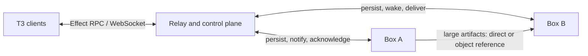

# Box communications

Status: architecture decision, not implemented. Updated 2026-08-30.

## Decision

Cloudbox keeps **Effect RPC over WebSocket** for T3 client, server, and box communication. Cross-box
work uses a durable message protocol built with Effect services and Effect Schema. ConnectRPC and
Protobuf may be added later as an interoperability adapter; they are not the internal source of
truth.

A box is already a complete persistent agent node. It runs the existing Claude, Codex, pi, Grok,
Cursor, OpenCode, and other configured harnesses. The design does not add a named-bot abstraction.



## Why

T3 already uses Effect RPC, Effect Stream, WebSockets, scoped fibers, typed failures, and Effect
Schema. Keeping that stack avoids a second schema system and makes cancellation, reconnection,
resource lifetimes, and tests use the same runtime.

ConnectRPC remains useful at a public or cross-language boundary. It offers generated clients and
Protobuf compatibility for Go, Rust, Swift, Kotlin, and other systems. It does not provide durable
delivery, offline mailboxes, wake policy, idempotency, or artifact storage. Browser transports also
do not provide the full-duplex behavior that the existing WebSocket channel provides.

## Message contract

The durable envelope is versioned and encoded from an Effect Schema.

```ts
type BoxMessage = {
  version: 1
  messageId: string
  idempotencyKey: string
  source: { boxId: string; threadId?: string; provider?: string }
  destination: { boxId: string; threadId?: string; provider?: string }
  kind: "task" | "status" | "artifact" | "cancel" | "ack"
  payload: unknown
  artifactRefs: ReadonlyArray<string>
  createdAt: string
  deadline?: string
}
```

The production schema must use typed payloads per `kind`; `unknown` above only keeps the design
example short. Large files, checkpoints, commits, and build results travel as content-addressed or
authenticated artifact references rather than inline message bytes.

## Delivery

1. The sender writes the message to the relay mailbox before delivery is attempted.
2. An online destination receives a push immediately. An asleep destination is woken because a
   task or direct agent delegation is explicit work.
3. The destination records the message before starting the selected harness or thread.
4. Completion, failure, cancellation, and artifact availability are later durable messages.
5. The receiver acknowledges the original `messageId`; the relay retries unacknowledged delivery.

Delivery is **at least once**. Receivers deduplicate by `messageId` and make operations idempotent
with `idempotencyKey`. Passive reconnect, status polling, presence, and heartbeats never wake paid
compute.

Expected message states are `queued`, `delivering`, `acknowledged`, `failed`, and `expired`. A
failure keeps its typed cause and retry disposition. Cancellation is a request and remains visible
until the destination confirms whether it interrupted work.

## Addressing and execution

The destination is an existing box, optionally narrowed to a T3 thread and provider harness. A box
may execute directly in its shared workspace, create a Git worktree, or use an Incus thread machine.
That placement choice is separate from message delivery.

Cross-box coordination transfers messages, commits, checkpoints, and selected artifacts. It does
not introduce a distributed filesystem or concurrent writers across machines.

## Security

- Authenticate the user, source box, and destination box on every mailbox operation.
- Bind short-lived delivery credentials to the requesting client or box; do not distribute broad
  cloud-provider credentials.
- Authorize artifact references separately and expire them.
- Treat every harness on one box as part of that box's user trust boundary.
- Record sender, destination, approvals, delivery attempts, and terminal outcome for audit.

## Effect replaces RxJS, not the wire protocol

Grok Bot's reconstructed runtime uses RxJS mainly for local process and event utilities. Cloudbox
does not need RxJS:

| RxJS concept | Effect equivalent |
| --- | --- |
| `Observable` | `Stream` |
| `Subject` | `PubSub` or `Queue` |
| `AsyncSubject` | `Deferred` |
| `Subscription` | scoped `Fiber` |
| `timer` | `Effect.sleep` or `Schedule` |
| `merge` | `Stream.merge` |

Effect supplies concurrency, cancellation, resource safety, retries, and typed errors. Effect RPC
supplies the current TypeScript RPC layer. ConnectRPC is a separate transport/interoperability
choice and can be exposed through an adapter without changing the domain protocol.

## Non-goals

- A new named-bot identity model.
- Exactly-once execution.
- A distributed filesystem or shared cross-box working tree.
- Copying live T3 SQLite databases as thread transfer.
- Replacing the existing T3 Effect RPC/WebSocket stack.

## Verification required before implementation is complete

- Message survives relay, sender, and destination restarts.
- Duplicate delivery starts work once.
- Explicit delegation wakes an asleep destination; background traffic does not.
- Acknowledgement loss causes safe redelivery.
- Cancellation and deadline races have deterministic terminal states.
- Artifact authorization and expiry work independently from message authorization.
- Web, desktop, and mobile observe the same durable state after reconnect.

