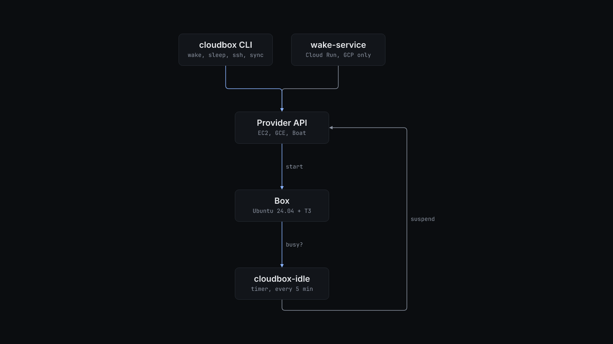

# How cloudbox works

The CLI loads `cloudbox.json` (`src/config.ts`), checks it against an Effect Schema union of the three provider shapes, and dispatches on `provider`. Unknown fields are an error.

**AWS and GCP.** `pnpm deploy` runs `alchemy.run.ts`. AWS gets a VPC, a security group that allows TCP 22 only from `aws.sshCidr`, an IAM role that can stop only instances tagged `cloudbox=<name>`, and one Ubuntu 24.04 instance with an encrypted gp3 disk and hibernation enabled at launch. GCP gets an SSH firewall rule for the IAP range, a separate data disk, one Ubuntu 24.04 instance, and a Cloud Run wake service. The box bootstrap clones `t3.repoUrl` and runs the T3 server as a systemd user service on `127.0.0.1:3773`.

**Sleep.** `cloudbox-idle.timer` runs `/opt/cloudbox/idle.mjs` every 5 minutes. The box is busy when `/run/cloudbox/keepawake` exists, when a `claude`, `codex`, `pi` or `opencode` process runs, or when T3 reports an active session. Each idle check adds to a streak stored in `/var/lib/cloudbox/idle.json`. When the streak reaches `idleMinutes`, AWS calls `StopInstances` with `Hibernate=true` and GCP calls `instances.suspend`. If the gap between two checks is more than three intervals, the box has just resumed, so suspension waits another `idleMinutes`. Run `sudo touch /run/cloudbox/keepawake` on the box to keep it awake.

**Wake.** `cloudbox wake` starts or resumes the instance through the provider API, waits until SSH answers, and prints the host. On GCP, `cloudbox wake --via-service` asks the deployed Cloud Run service to do it with `CLOUDBOX_WAKE_URL` and `CLOUDBOX_WAKE_SECRET`, so the caller needs no GCP credentials.

**Verify.** `verify` runs named checks over SSH. `verify-sleep` sleeps and wakes the box and checks that uptime and a marker process survived. `verify-idle` leaves the box alone for `idleMinutes + 5` minutes and checks that it went to sleep. Each prints a table, or JSON with `--json`, and exits non-zero when a check fails.

**Boat.** Boat has no deploy step and no idle timer. `cloudbox boat up` creates or resumes one sandbox named `cloudbox-<name>`, sets its TTL to `boat.ttlSeconds`, syncs the identity paths, and writes a managed `Host cloudbox-<name>` block into the Windows OpenSSH config. `boat ssh`, `boat exec` and `boat proxy` refuse a stopped sandbox. Only `boat up` and `boat resume` start one. See [the Boat provider guide](boat-provider.md).

**Sync.** `cloudbox sync` copies each `identity.paths` entry with rsync. It first runs a dry run, totals the bytes, and stops if the total exceeds `identity.maxTransferMb` unless you pass `--force`. It then clones or fetches each `repos` entry and, when `t3.settingsParity.enabled` is true, merges portable T3 settings. `bootstrap-clone --from-config <source.json>` copies paths allowlisted in both configs from another box through a private local cache. It never deletes files on the destination.

The [product description](product-description.md) describes the lifecycle and the loadout clone event by event.
