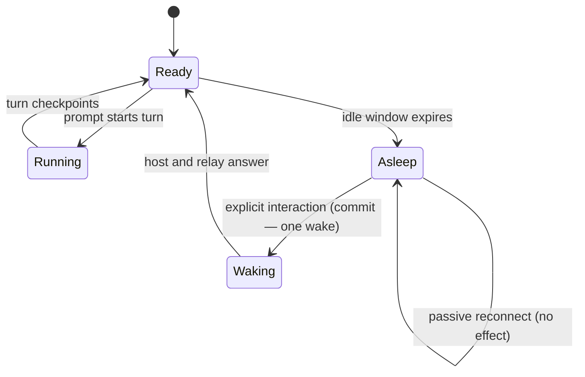
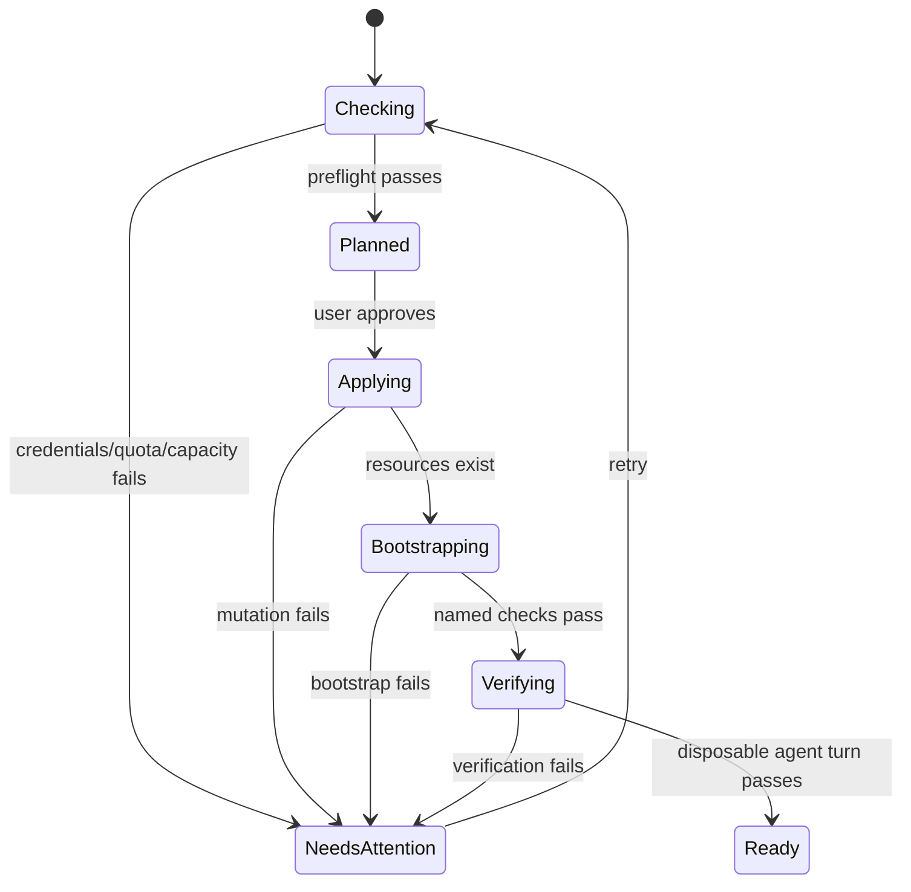
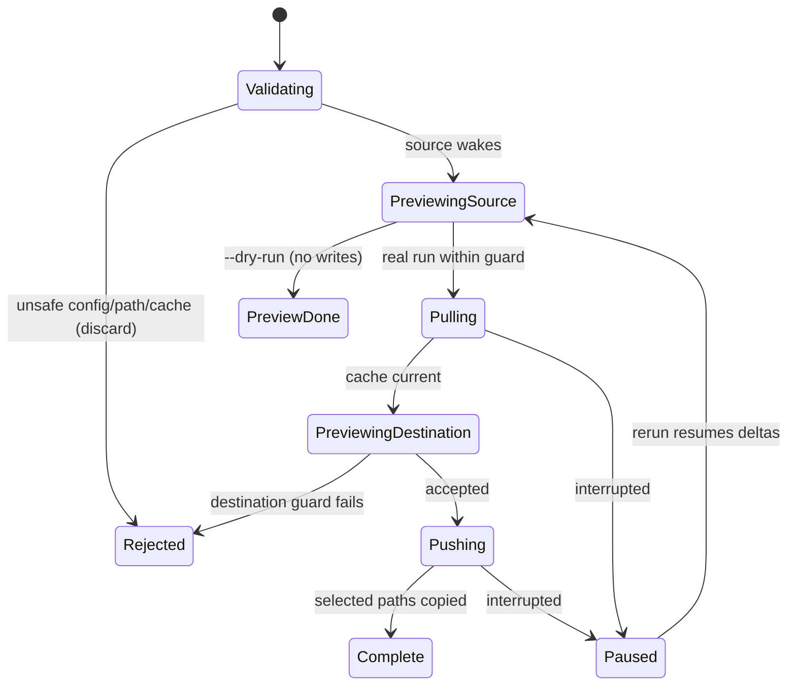

# Cloudbox product description

Status: current behavior and the next product boundary, 2026-08-29. Source baselines: Cloudbox
`551b0c6`; T3 Code fork `999e25ba`.

## Summary

Cloudbox is a persistent personal coding environment in the user's cloud account. T3 Code reaches
it from desktop, web, or mobile; enabled projects run each thread's agent in an isolated machine.
The host sleeps when idle and an explicit interaction wakes it automatically.

The complete GCP path works today. Provisioning and upgrades still use the operator CLI rather than
a T3 Compute screen. Selective file/folder loadouts have a tested CLI primitive. The picker,
selected-thread export, and automatic work routing are not implemented.

| Capability | Current state |
| --- | --- |
| Provision GCP | Operator config plus `pnpm deploy`; infrastructure and guest bootstrap are separate phases. |
| Provision AWS | Implemented, but limited compared with the GCP thread-machine path. |
| Sleep and return | Prompts and explicit interactions wake the host without a preliminary Wake or Reconnect press. |
| Isolated agent work | Codex, pi and Claude have real thread-machine verification; OpenCode is implemented but unverified there. |
| Selective loadout | Implemented for chosen files/folders with resumable rsync deltas. |
| T3 loadout picker | Not implemented; paths are declared in config. |
| Selected-thread transfer | Not implemented; it needs a consistent T3 export rather than copying SQLite files. |
| Provision/upgrade from T3 | Not implemented; the safe operation model is defined below. |
| Route work across a box pool | Later; not part of the current product. |

## Everyday use

The user opens T3, selects the Cloudbox environment and works normally. If the host is asleep,
sending a prompt, answering an approval, connecting, or explicitly retrying a tool arms one wake
and starts reconnection. A submitted web prompt stays queued; mobile uses its durable outbox.
Passive startup and background reconnect never wake paid compute.

When **Thread machines** is enabled, a new thread receives a machine, branch and workspace. The
agent runs as the user in `/home/dev/ws`, with selected identity and settings mounted from the
host. Running agents and connected clients keep the host awake.



**Wake now** remains a diagnostic fallback, not a normal prerequisite.

## Provisioning and upgrades

Today the operator creates `cloudbox.json`, authenticates the provider, builds bundles and runs
`pnpm deploy`. Cloud resources can finish before guest bootstrap. The operator then verifies the
host, previews/applies identity sync, authenticates uncopied agents, links T3 Connect, and runs a
test thread. “Resources exist” is not the same state as “Ready to code.”

The target T3 **Compute** area shows each box's state, provider/region, compute profile, active work,
versions, drift, loadouts and estimated active/sleeping cost. Its actions are **Add box**,
**Upgrade**, **Change compute**, **Sleep now**, and **Open**.



The plan must state replacements, downtime, retained data, cost and rollback boundary before a
mutation. An in-place upgrade drains new work, snapshots rollback state, applies the idempotent
bootstrap/T3 build and verifies one disposable turn. Replacement becomes a move operation;
changing provider is never presented as an ordinary edit.

The first durable executor may be the signed-in desktop that owns cloud CLI credentials. Web/mobile
can monitor and approve it. Broad provider credentials do not belong in the relay, browser, phone,
or worker agents.

## Selective loadout clone

### Summary

A loadout is a selected set of ordinary files/folders from the current box: projects, GitHub CLI
configuration, Git config, dotfiles, agent settings, skills, caches, or chosen home-relative paths.
It reproduces the working setup on another box without cloning the VM, disk, OS, or all T3 state.

```bash
pnpm cloudbox bootstrap-clone --from-config ../source/cloudbox.json --dry-run
pnpm cloudbox bootstrap-clone --from-config ../source/cloudbox.json
```

Both configs must allowlist every path. Excludes are combined and the smaller transfer limit wins.

### The simple case

The operator selects `~/.config/gh/`, `~/.gitconfig`, `~/.agents/skills/`, and `~/src/`. Dry run
wakes only the source and shows its delta into a private local cache. A real run wakes both boxes,
refreshes the cache, previews the destination delta, applies the guard, and copies it. Reruns send
only changed bytes. Destination-only files remain; a selected same-name source file replaces its
destination version. No implicit delete runs.

### The interaction, event by event



#### Starting

Invocation fixes the source/destination configs, selected paths, combined excludes, smaller limit,
cache, dry-run state and force override. The boxes must differ. Paths start with `~/` and cannot
escape the user's home.

#### Ending at once

Invalid configs, mismatched allowlists, identical boxes, or an unsafe cache stop before transfer. A
dry run ends after source preview and never contacts the destination.

#### Becoming extended

A real run creates or reuses a mode-0700 cache, previews/checks the source pull, then starts rsync.
Partial cache files may remain after interruption.

#### While extended

Rsync prints names/statistics and uses compression, protected arguments and partial files. The user
may interrupt; completed and partial cache data remains. No browser/T3 session is kept open.

#### Finishing

The destination receives its own preview/guard before writes. The cache stays for cheap reruns. The
command reports completion but does not restart tools whose configuration changed.

### Modifiers

| Variant | Set at start | Changed while running |
| --- | --- | --- |
| `--dry-run` | Source preview only. | No effect. |
| `--force` | Bypasses byte limits only. | No effect. |
| `--cache-dir` | Chooses a persistent cache; existing directory must be private. | No effect. |
| Provider | Selects direct AWS SSH or GCP SSH through IAP per box. | No effect. |
| Trailing slash | Copies directory contents; a file stays one file. | No effect. |

### Cancel and interrupt

| Event | Before extended | While extended |
| --- | --- | --- |
| User cancels | Nothing changes. | Process exits; completed/partial cache files and completed destination files remain. |
| User does something else | No effect. | Editing selected files produces a newer delta on rerun. |
| Environment fails | Error names path and transfer leg. | Recover and rerun; rsync resumes changed data. |
| Target changes | Invocation uses configs already read. | Rerun reads the new config. |
| Input channel changes | CLI stays with its executor. | Another device cannot observe/resume it yet. |

### Interactions with other systems

**Permissions.** The cache is private. Credentials move only when their exact path is selected.

**History.** Ordinary loadouts do not transfer conversations. Selected threads need T3 export.

**Machines.** This copies host-home paths, not Incus machines, and creates no concurrent writers.

**Asleep host.** Invocation explicitly wakes required boxes; dry run leaves destination asleep.

**Multiple devices.** Operation/cache live on the invoking machine; no shared record exists yet.

**Notifications.** Progress is terminal output only.

**Settings.** Selectors live in config; cache and destination-only files persist.

### Edge cases

- A live SQLite database is not an ordinary loadout file.
- Same-name selected destination files are overwritten after preview.
- Excluded children are not deleted from the destination.
- `--force` bypasses limits, not validation, allowlists, or cache privacy.
- Default cache identity includes provider, location/project and box name.

### Open questions and verification

- Locally verified: config validation, resumable/protected rsync args, source-only dry run,
  pull-before-push ordering, guards, malformed stats, typecheck, bundle and CLI help.
- Not live verified: two-host interruption/resume, AWS↔GCP transfer, or large sparse files.
- Product gaps: T3 picker, durable progress, conflict choices, notifications, selected-thread export.

## Mobile

Mobile can discover/use linked environments, continue threads, choose agent/model, see account host
state, and arm wake through explicit interaction. Account wake still needs deployed-relay and
real-device asleep → prompt → connected verification.

Provisioning, upgrades and loadout clone are not mobile operations today. Target behavior lets the
phone approve/monitor a durable desktop/runner operation; backgrounding cannot stop it.

## Later: cloud lab

A homelab-like cloud pool with agent routing is later. The current implementation does not claim a
scheduler, distributed filesystem, multi-box coherence, or automatic provisioning. When built,
each writable workspace should have one owner; agents exchange commits, checkpoints and artifacts.

## Verification record

See [product-description verification](product-description-verification.md).
